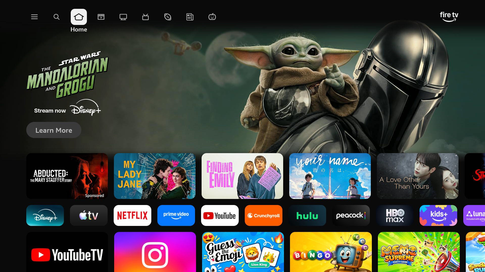
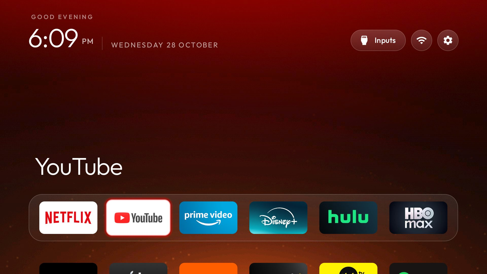
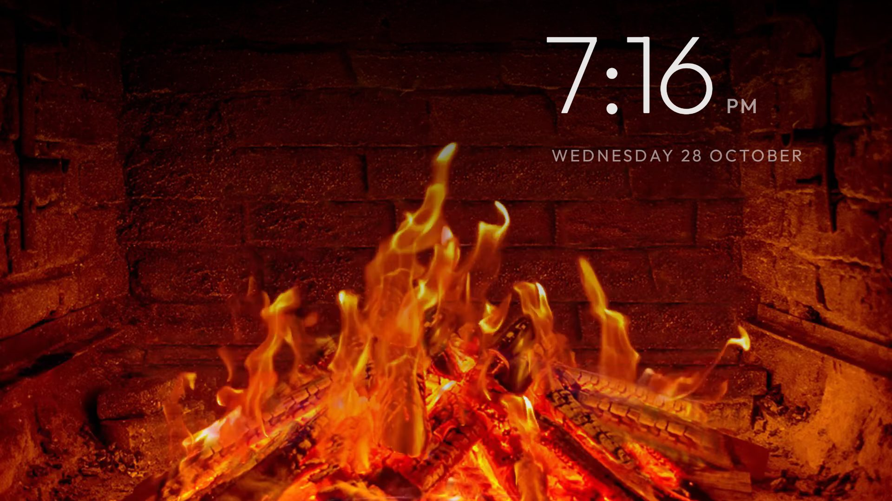
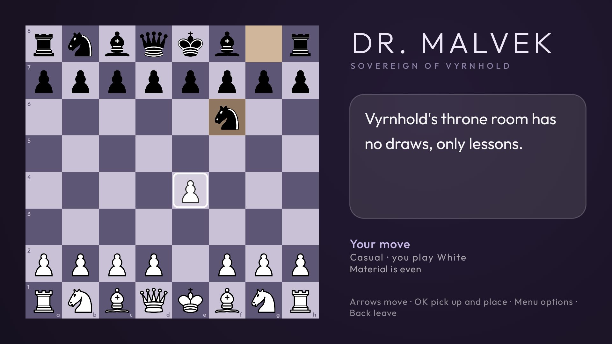
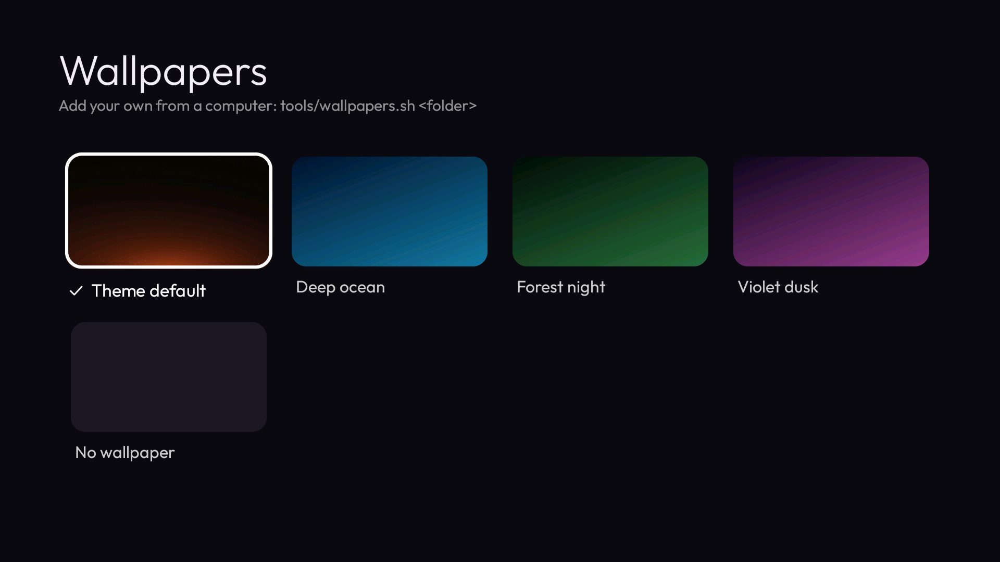

# Hearth

A clean home screen for Amazon Fire TV. No sponsored rows, no autoplaying ads, no tracking: your apps, a clock,
and a glow in the colour of whatever you're about to watch. Plus a fireplace, a chess villain, and your phone as a
companion for all of it.

| Before | After |
|---|---|
|  |  |

Fire OS won't let another app become Home, so Hearth doesn't fight it: a small accessibility service watches for
Amazon's home screen and opens Hearth in its place. Amazon's launcher stays installed and enabled, and pressing
Home twice in a row still gets you to it.

## What it does

- **Home.** Your dock of apps, the rest in a grid, a thin clock, and a glow taken from the focused app. Three
  themes, a Wallpapers button in the top bar, and an app library.
- **Debloat.** Disables Amazon's content recognition (ACR), shopping, telemetry, tutorials and preloads with
  `pm disable-user`, from a tested list for your model. Nothing is uninstalled; one command brings it all back.
- **Ambience.** Fireplace, rain on the window, an aquarium, snowfall and the ocean at dusk: real footage looped
  without a seam, with the clock drifting above it. Left and Right change the scene. Set `"fireplace": true` in a
  theme to make it Home's idle screen.
- **Chess against Dr. Malvek.** The Sovereign of Vyrnhold, a theatrical armored tyrant who speaks of himself in the
  third person and has something to say about your captures, checks and blunders. Three levels, played with the
  remote, saved after every move. Give Hearth a Claude API key and his lines are written live for each moment.
- **Your phone as a companion.** Open the address shown on the Wallpapers screen: start apps, scenes and Chess,
  pick a wallpaper, or send a photo from your phone straight to the TV.
- **Ad-blocking DNS**, optional: Private DNS through AdGuard for the whole TV.

| Ambience | Chess | Wallpapers |
|---|---|---|
|  |  |  |

## Install

On the TV: Settings > My Fire TV > About, press OK on the first entry seven times, then back to Developer options
and switch **ADB debugging** on.

On a Mac or Linux computer on the same network:

```bash
git clone https://github.com/Srikarmk/hearth && cd hearth
TV_HOST=192.168.1.50 DNS=1 THEME=themes/ember ./install.sh
```

Accept "Allow USB debugging?" on the TV when it asks. The script backs up the TV's packages and settings to
`backup/`, applies the debloat list for your model, installs Hearth and points Home at it. With JDK 17 and the
Android SDK it builds Hearth from source; without them it downloads the latest release. Switch ADB debugging off
when you're done.

| Option | What it does |
|---|---|
| `LIST=lists/<file>.txt` | Pick a debloat list yourself |
| `SKIP_DEBLOAT=1` | Install Hearth only |
| `DNS=1` | Ad-blocking Private DNS |
| `THEME=themes/<name>` | Push a theme at the end |
| `SCREENSAVER=1` | Hearth's clock (and ambience, with `"fireplace"`) as the system screensaver |
| `CLAUDE_API_KEY=sk-ant-...` | Live Dr. Malvek, billed to that key |
| `HEARTH_APK=<file>` | Install a given APK |

Undo all of it with `TV_HOST=192.168.1.50 ./uninstall.sh` (`KEEP_DEBLOAT=1` removes only Hearth).

### Supported TVs

Any Fire TV on Fire OS 7 or 8 (Android 9 or 11) for Hearth itself. Tested debloat lists, picked automatically:

| Model | Device |
|---|---|
| AFTHY7ABBA | Fire TV smart TV (`ginza`), Fire OS 8 - Hearth's home TV |
| AFTDEC012E, AFTOLCBC82 | TCL / Hisense Fire TV smart TVs (`ginza`) |
| AFTKM, AFTKA | Fire TV Stick 4K (2023), Stick 4K Max (2021) |
| AFTSS | Fire TV Stick Lite (2020) |
| AFTMM | Fire TV Stick 4K (2018) - debloat only, Fire OS 6 is below Hearth's minimum |
| AFTTIFF43, AFTEU014 | Amazon Fire TV 4K and Omni smart TVs |
| AFTCIBFBD1, AFTDCT31, AFTEAMR311, AFTSHN02, AFTMA2857F, AFTHA004 | Hisense, Insignia, TCL, Xiaomi and Toshiba Fire TV sets |

The lists come from [cleanyourtv](https://github.com/Gathin23/cleanyourtv)'s contributors. A TV without one still
gets Hearth; pass `LIST=` to try the nearest list.

## Your own wallpapers

From your phone, use the companion page. From a computer:

```bash
TV_HOST=192.168.1.50 tools/wallpapers.sh ~/Pictures/tv
```

Every JPG, PNG or WebP in the folder (up to 10 MB each, 100 in all) goes to the TV for the Wallpapers button; the
file names become the titles. The pictures stay on your computer and your TV, never in this repo. A theme push
replaces them, so run it again after `tools/theme.sh`. `tools/wallpapers.sh --clear` removes them.

## Themes

| Theme | Look |
|---|---|
| `themes/ember` | Charcoal with a low ember glow and drifting sparks; the fireplace after 3 idle minutes |
| `themes/midnight` | True black for OLED, a quiet rim highlight |
| `themes/daybreak` | A sky backdrop that follows the time of day, frosted dock |

```bash
TV_HOST=192.168.1.50 tools/theme.sh themes/midnight
```

A theme is a `config.json` plus an optional `wallpaper.jpg`; the keys are cleanyourtv's, plus `fireplace`,
`wallpaper_button` and `companion`. The Ember wallpaper is made by `themes/ember/make_wallpaper.py`.

## Network and privacy

Hearth sends nothing about you anywhere. What it does use the network for:

| What | Where | When |
|---|---|---|
| Ambience scenes | upload.wikimedia.org | The first time each scene is picked (19 to 65 MB each), then never again |
| Phone companion | Your home network only, port 8765 | While Hearth runs; every action needs the 4-digit code on the TV. `"companion": false` closes it |
| Live Dr. Malvek | api.anthropic.com | Only with a Claude API key on the TV, one short request per line, billed to your key (about half a cent each) |

The debloat turns off Amazon's own telemetry and content recognition, and the optional DNS blocks ad and tracker
domains for every app on the TV.

## Building and releases

`launcher/` is a Gradle project (JDK 17, Android SDK platform 34, build-tools 34.0.0):

```bash
cd launcher && ./gradlew testReleaseUnitTest lintRelease assembleRelease
```

Release builds are signed with the key in `~/.config/hearth/signing.properties` when there is one (`storeFile`,
`storePassword`, `keyAlias`, `keyPassword`), and with the debug key otherwise. CI runs the tests, lint and
shellcheck on every push; pushing a tag like `v0.2.0` builds a signed APK and publishes it as a GitHub release
(repository secrets `HEARTH_KEYSTORE_B64` and `HEARTH_KEYSTORE_PASSWORD`).

`tools/dev/companion_mock.py` serves the phone page with a fake TV behind it, for working on the page without one.

## Tested on

Amazon Fire TV AFTHY7ABBA (`ginza`), Fire OS 8.1.8.5 / Android 11: Home takeover with the real remote and after a
reboot, the fireplace, Chess, the Wallpapers button and `tools/wallpapers.sh`. Rain, aquarium, snow and ocean
scenes, the phone companion, Live Dr. Malvek and the screensaver option are built and unit tested, not yet run on
a TV.

## Credits

Hearth started from [cleanyourtv](https://github.com/Gathin23/cleanyourtv) by Gathin and borrows its Home redirect
from [bansiman's Home Return](https://github.com/bansiman/cleanyourtv/tree/my-tv). Scene footage and chess pieces are
from Wikimedia Commons under Creative Commons licences; every source is in [CREDITS.md](CREDITS.md). MIT licensed.
